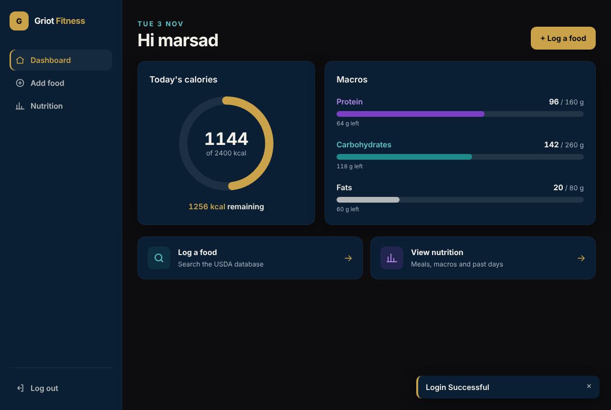
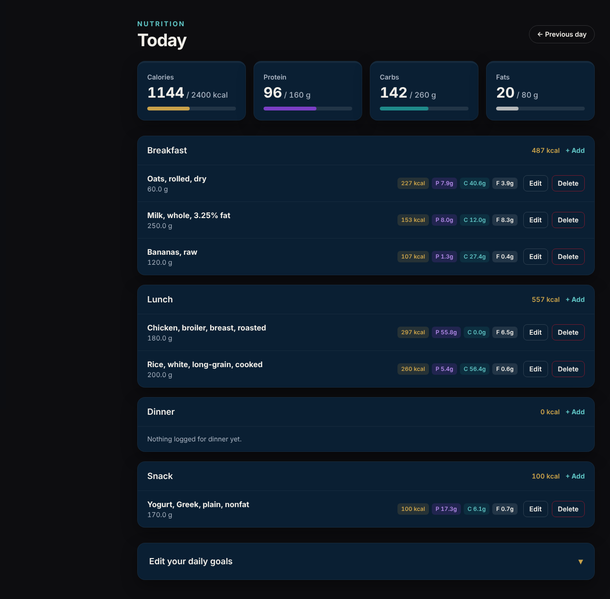
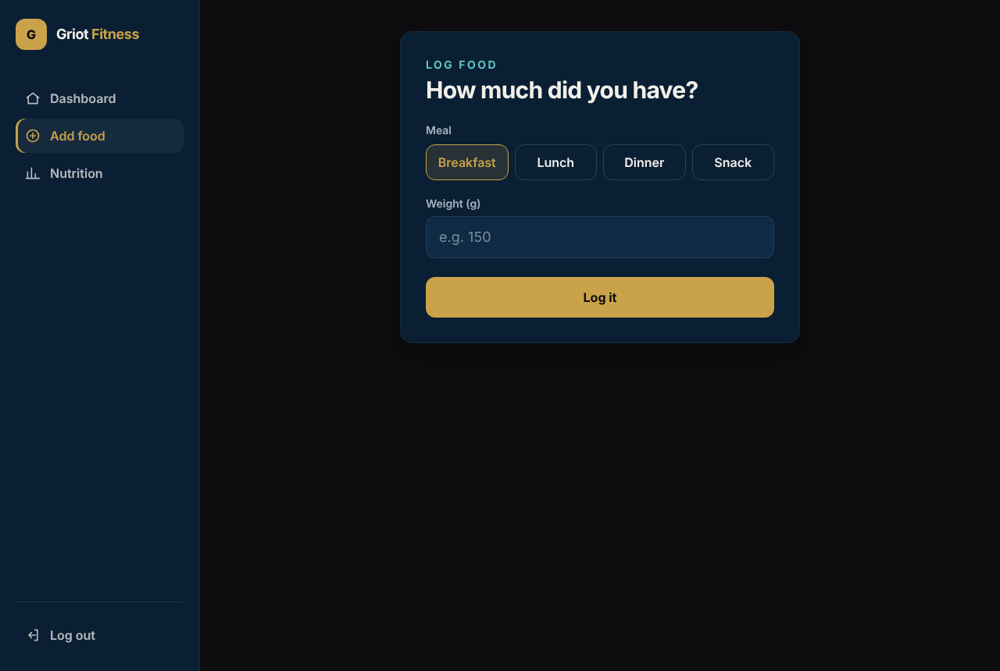

# Griot Fitness

A calorie and macro tracker built with Flask. Search real foods from the USDA FoodData Central database, 
log what you eat by the gram, and see your calories, protein, carbs and fats add up against your own daily goals.



## Features

- **Accounts** – register, log in and log out. Passwords are hashed, and each user only ever sees their own data.
- **Food search** – search the USDA FoodData Central database and pick the closest match.
- **Log by weight** – enter how many grams you had and the calories and macros are scaled to match.
- **Nutrition page** – everything logged for the day, grouped into breakfast, lunch, dinner and snack, with a calorie
subtotal for each meal.
- **Past days** – step back through previous days with Previous / Next day links.
- **Daily goals** – set calorie, protein, carbs and fats targets and track progress with bars.
- **Dashboard** – today's calories as a progress ring, macro bars, and how much is left (or how far over).
- **Edit and delete** – change the weight or meal of any entry, with macros rescaled automatically.
- **Search caching** – repeat searches come from a 30-day cache instead of calling USDA again, so popular searches keep
working even if the API is down.
- **Responsive design** – sidebar layout on laptops, bottom tab bar on phones.


## Built with

- **Backend:** Python, Flask, Flask-SQLAlchemy
- **Database:** MySQL
- **API:** [USDA FoodData Central](https://fdc.nal.usda.gov/api-guide)
- **Frontend:** Jinja templates, Tailwind CSS, animate.css

## Screenshots

| Nutrition | Logging a food |
|---|---|
|  |  |

## Running it locally

1. **Clone the repo**
   ```bash
   git clone https://github.com/Marsad07/FitnessApp.git
   cd FitnessApp
   ```

2. **Create a virtual environment and install the requirements**
   ```bash
   python -m venv .venv
   .venv\Scripts\activate        # Windows
   # source .venv/bin/activate   # Mac / Linux
   pip install -r requirements.txt
   ```

3. **Get a free USDA API key** from [api.data.gov/signup](https://api.data.gov/signup/).

4. **Create a `.env` file** in the project folder with these keys:
   ```
   DB_HOST=localhost
   DB_PORT=3306
   DB_USER=your_mysql_user
   DB_PASSWORD=your_mysql_password
   DB_NAME=fitnessapp_db
   DB_SSL=false
   SECRET_KEY=any_long_random_string
   USDA_API_KEY=your_usda_api_key
   ```
   `DB_SSL=true` turns on the encrypted connection that hosted databases like TiDB Cloud need.

5. **Create the database** by running `database/schema.sql` in MySQL Workbench (or the `mysql` command line).

6. **Run the app**
   ```bash
   flask --app main run
   ```
   Then open http://127.0.0.1:5000.

## Changing the styling

The pages use Tailwind CSS. The built file `app/static/css/tailwind.css` only contains the classes the templates
use, so after adding new Tailwind classes, rebuild it (needs Node.js):

```bash
npx tailwindcss@3.4.17 -c tailwind/tailwind.config.js -i tailwind/input.css -o app/static/css/tailwind.css --minify
```

## Deployment

The live version runs on [Render](https://render.com) (free web service) with a free
[TiDB Cloud](https://tidbcloud.com) MySQL-compatible database.

- **Build command:** `pip install -r requirements.txt`
- **Start command:** `gunicorn main:app`
- **Environment variables:** the same keys as the `.env` file above, with `DB_PORT=4000` and `DB_SSL=true` for TiDB

The free plan sleeps after 15 minutes without visitors, so the first visit after a quiet spell can take around 30
seconds to load.

## Project structure

```
FitnessApp/
├── main.py                 # Loads .env and starts the app
├── app/
│   ├── __init__.py         # create_app(), database setup, homepage / dashboard route
│   ├── routes.py           # Search, logging, nutrition, goals, edit and delete
│   ├── auth_routes.py      # Register, login, logout
│   ├── decorators.py       # @login_required
│   ├── models/             # User, LoggedEntry, Nutrition (goals), FoodCache
│   ├── templates/          # Jinja templates
│   └── static/css/         # Built Tailwind CSS + extra animations
├── services/
│   └── food_service.py     # USDA API calls + search cache
├── database/
│   └── schema.sql          # Creates all the tables
└── tailwind/               # Tailwind config (palette) + source file for rebuilding the CSS
```

## What I learned

I built this project feature by feature over a few weeks, testing each step before moving on. These are the things
that stuck with me most.

### Flask and project structure
- **Splitting an app into blueprints** – food and nutrition routes live in one blueprint, accounts in another, so each
  file has one job.
- **Template inheritance** – one `base.html` holds the layout, nav and messages, and every page extends it, so a change
  in one place updates the whole site.
- **`url_for` instead of typed URLs** – links are built from function names, so renaming a URL can't break them (and
  renaming a function will, which taught me why names matter).
- **Shared helpers** – moving the "add up the day" logic into one function (`get_day_summary`) so the dashboard and
  nutrition page can never disagree.
- **Writing my own decorator** – `@login_required` replaced the same login check copied into four routes. Getting the
  order of decorators wrong silently removes the protection, which I only found by testing.
- **Circular imports** – why some imports have to go inside a function instead of at the top of the file.

### Validating input
- **Never trusting anything from the browser** – `required` and `min` in the HTML can be removed in DevTools, so every
  value is checked again on the server, including dropdown values.
- **Converting before comparing** – form values always arrive as text, so they're turned into numbers inside
  `try/except (ValueError, TypeError)` before any range check.
- **`None` vs `""`** – an empty box gives an empty string, a missing field gives `None`, and
  `(request.form.get(...) or "").strip()` handles both.
- **Edge cases that only show up in testing** – `nan` passes normal range checks (every comparison with it is false),
  and a `DECIMAL(6,2)` column can only hold up to 9999.99.

### Accounts and security
- **Password hashing** – passwords are stored as salted hashes, never as text, and checked with
  `check_password_hash` because hashing the same password twice gives different results.
- **Sessions** – the logged-in user's ID lives in a signed session cookie, which can be read but not changed.
- **Ownership checks** – every query filters by the user ID from the session, so changing an ID in the URL just says
  "this food does not exist" instead of showing someone else's data.
- **Same message for wrong email or wrong password** – so the login page can't be used to find out who has an account.
- **GET vs POST** – anything that changes data (logging, editing, deleting, saving goals) goes through POST, and
  passwords never go in the URL.

### Databases
- **Designing tables** – users, entries, goals and a cache, linked with foreign keys, with `unique` and `nullable` doing
  some of the validation for me.
- **Changing a live table** – the model alone doesn't change MySQL, so new columns and constraints need `ALTER TABLE`.
- **`ON DELETE CASCADE`** – deleting a user removes their entries and goals too, instead of being blocked by them.
- **Date boundaries** – a day runs from midnight (inclusive) to the next midnight (exclusive), tested at 23:59 and 00:00.

### Working with an external API
- **Timeouts and network errors** – every USDA call has a timeout and catches `requests` errors, so a slow or broken
  API shows a message instead of hanging or crashing the page.
- **Telling failure apart from "nothing found"** – `None` means the API failed, an empty list means the search worked
  but found nothing, and they get different messages.
- **Caching** – search terms are normalised, results expire after 30 days, and failures are never cached.

### How I work
- **Planning in plain English first** – writing out what each feature needs before coding it saved a lot of rewriting.
- **Reading errors from the bottom up** – most tracebacks point straight at the problem (a missing `return`, a leftover
  import, a template name that doesn't match).
- **Testing the bad cases, not just the happy path** – empty boxes, letters instead of numbers, future dates, and
  logging in as a second user to try to reach the first user's data.
- **Small commits** – one change per commit with conventional prefixes (`feat:`, `fix:`, `refactor:`).

## What's next
- Automated tests with pytest
- Deploying a live version
- Logging food to past days, and a 7-day calorie history chart
